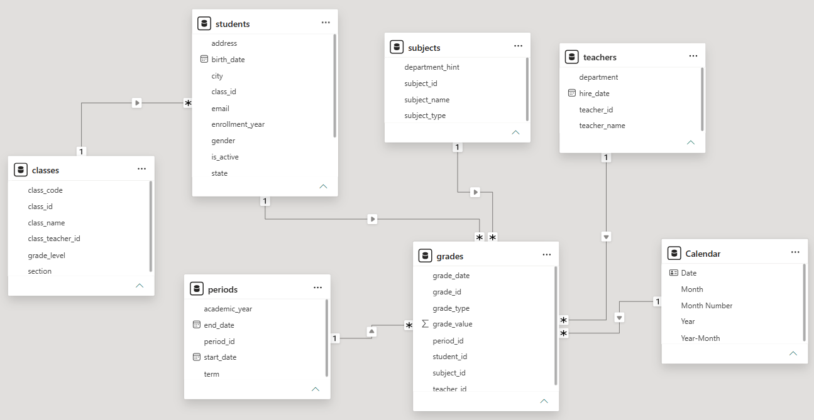
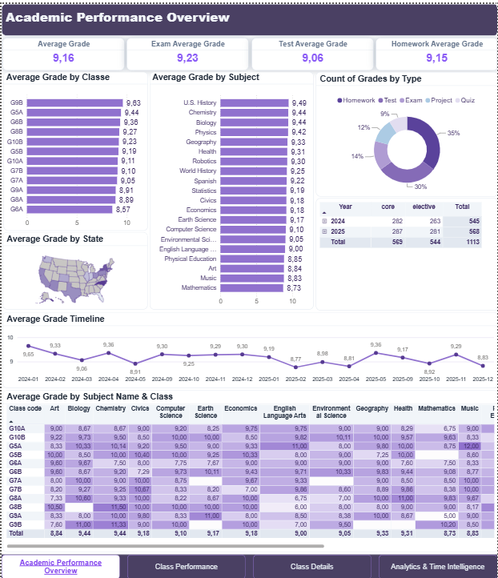
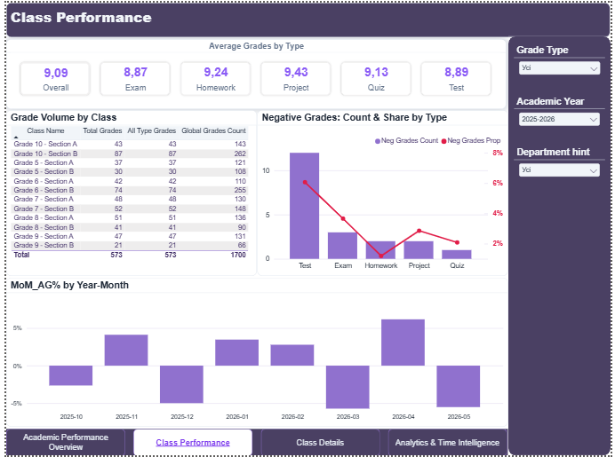
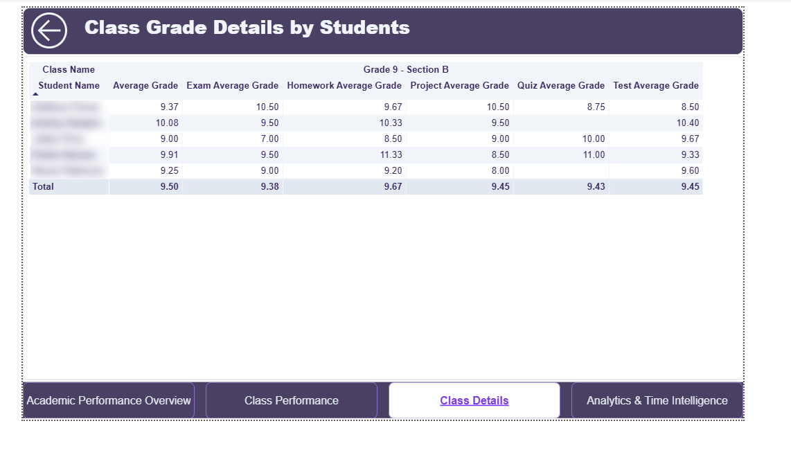
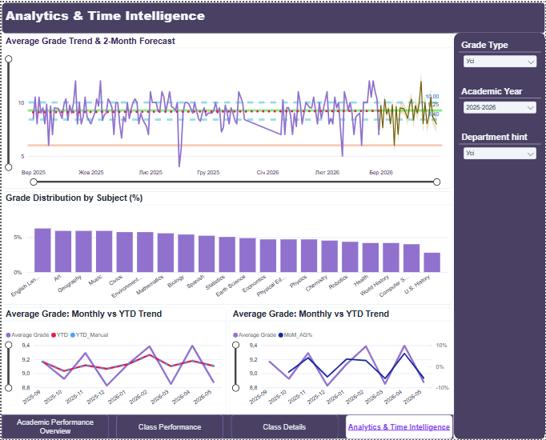

# School Gradebook Analytics Dashboard

**Power BI · Power Query · DAX**

An interactive Power BI dashboard for a school moving to an electronic gradebook. Six separate CSV files (students, classes, teachers, subjects, periods, grades) are cleaned, joined into one data model, and turned into a four-page report on academic performance.

> Training project (course dataset with synthetic data).

---

## 🎯 Goal

Give school management one place to see how students are doing:

- What is the average grade by subject and class?
- How do grades change over time, month to month?
- Which types of grades (exam, test, homework, project, quiz) are given, and how do they differ?
- How many negative grades are there, and where?
- Which classes and subjects stand out, good or bad?

---

## 🗂 Data and model

Six CSV files with the school gradebook:

| File | Content |
|---|---|
| `grades` | Fact table: one row per grade (value, type, date) |
| `students` | Students, their class, city and state |
| `classes` | Class code, grade level, section |
| `teachers` | Teachers and departments |
| `subjects` | Subjects, core / elective |
| `periods` | Academic year and semester |

**Data model.** `grades` is the fact table. `students`, `subjects`, `teachers`, `periods` and a `Calendar` table (created in DAX) connect to it with one-to-many relationships and single-direction filtering. `classes` connects through `students`.



**Data preparation in Power Query**
- Imported the CSV files and set correct data types
- Unified dates using the en-US locale
- Handled incorrect and blank values
- Checked keys for gaps and duplicates

---

## 🔧 What I built

The report has four pages with one style, a header, a KPI zone and an analytics zone, and navigation buttons between pages.

| Page | What it shows |
|---|---|
| **Academic Performance Overview** | KPI cards, average grade by class, subject and state, grade types, timeline, subject × class matrix |
| **Class Performance** | Average grade by type, grade volume by class, negative grades (count and share), month-over-month change |
| **Class Details** | Drill-through page: average grade of every student in a chosen class, overall and by grade type, with a back button |
| **Analytics & Time Intelligence** | Trend with a 2-month forecast, grade distribution by subject, monthly vs. YTD average |

**DAX measures** (in a separate `_Measures` table)
- Average grade with different filter behavior (`CALCULATE`, `ALL`)
- Month-over-month change (MoM%)
- Year-to-date (YTD) average, compared with a quick measure

**Other features:** slicers (grade type, academic year, department), drill-down hierarchies, conditional formatting, tooltip page, drill-through, trend lines, forecast with confidence interval.

---

## 📈 Results

### Key findings

- **Average grade is 9.16.** Exams (9.23), homework (9.15) and tests (9.06) are close.
- **Best and weakest classes.** Grade 9-B leads (9.63). Grade 6-A is the lowest (8.57).
- **Best and weakest subjects.** U.S. History is the highest (9.49). Mathematics is the lowest (8.73).
- **Tests are the weak point.** They have the most negative grades and, with exams, the lowest average (8.89 and 8.87 in 2025–2026).
- **No steady trend.** The median daily average is 9.25, and month-over-month change goes up and down between about −5% and +6%.

### Recommendations

1. **Support the weakest classes.** Look at Grade 6-A first, then 8-A and 9-A.
2. **Review Mathematics.** It has the lowest average of all subjects, so check why.
3. **Help students prepare for tests and exams.** They bring the most negative grades and the lowest averages.
4. **Use the Class Details page.** In the weakest classes, open the student list and find who needs extra attention.

---

## 🖼 Screenshots

**Academic Performance Overview**<br>


**Class Performance**<br>


**Class Details (drill-through)**<br>


**Analytics & Time Intelligence**<br>


---

## 🛠 Skills demonstrated

| Area | Skills |
|---|---|
| **Data preparation** | CSV import, Power Query cleaning, data types, date locale, key checks |
| **Data modeling** | Star schema, fact and dimension tables, one-to-many relationships, DAX calendar table |
| **DAX** | `CALCULATE`, `ALL`, MoM%, YTD, quick measures, calculated columns |
| **Visualization** | KPI cards, bar, donut, line and combo charts, matrices, maps, conditional formatting |
| **Interactivity** | Slicers, cross-filtering, drill-down, drill-through, tooltip page, navigation buttons |
| **Analytics** | Trend lines, percentiles, forecast with confidence interval, time intelligence |

---

## 📁 Repository structure

```
school-gradebook-powerbi/
├── README.md
└── images/
    ├── data-model.png
    ├── dashboard-overview.png
    ├── dashboard-class-performance.png
    ├── dashboard-class-details.png
    └── dashboard-analytics.png
```
